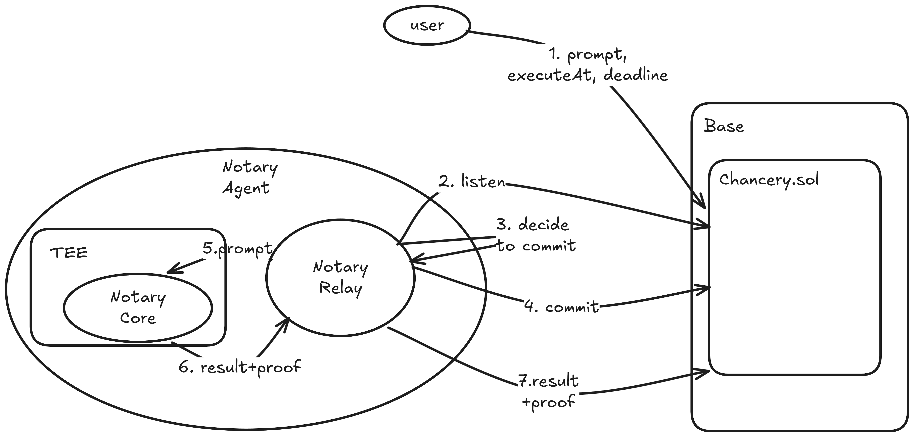

# Prompt Oracle

A TEE-attested AI oracle on Base. Anyone submits a prompt, a TEE-hosted LLM
answers it, and the response carries a hardware-rooted signature chain that
the contract verifies before storing it. The result is on-chain, replayable,
and tamper-evident: the prompt that produced the response is exactly what
was submitted, evaluated by the exact code attested by Intel TDX hardware.

PromptChancery is the substrate. BetMarket is one application built on it
(see [BETMARKET_DESIGN.md](BETMARKET_DESIGN.md)); other dapps can use the
same primitive without coordinating.

## Architecture

The system has three actors:

- **User** — submits prompts and reads results from the chain. Any wallet.
- **Chancery.sol** — `PromptChancery` on Base. Stores prompts, verifies
  TEE signatures, stores responses.
- **Notary Agent** — a single off-chain operator that runs both:
  - **Notary Relay** — Node.js process. Watches `PromptRequested` events,
    decides which to take, calls `commitToPrompt`, calls the Notary Core,
    and submits the resulting proof on chain. Holds an EOA key for paying
    gas. **Untrusted by the contract.**
  - **Notary Core** — code running inside a Phala TDX enclave. Receives a
    prompt, calls the LLM, signs `keccak256(prompt, response, timestamp)`
    with a key derived inside the TEE from a KMS root.



The numbered arrows in the diagram above:

1. **`submitPrompt(prompt, executeAt, deadline)`** — user opens a prompt
   on chain. Status becomes `Open`.
2. **listen** — the relay subscribes to `PromptRequested` (WebSocket if
   configured, else 60s polling fallback).
3. **decide to commit** — relay-internal logic: filter by execution
   window, agent capacity, etc. Multiple agents may compete; the first
   to commit wins.
4. **`commitToPrompt(promptId)`** — relay claims the prompt on chain.
   Status becomes `Committed`. Then waits until `promptAfter`.
5. **prompt** — relay forwards the prompt to the Notary Core via
   `POST /prompt`. In the live deployment this hop is HTTPS to the
   Phala-hosted enclave; in tighter setups the relay can run inside the
   same VM and call localhost.
6. **result + proof** — Notary Core calls the LLM, signs the
   `(prompt, response, timestamp)` hash with its TEE-derived key, and
   returns the response plus the full signature chain (derived → app →
   KMS root).
7. **`submitProof(promptId, …)`** — relay submits the response and proof
   on chain. PromptChancery verifies the chain inline (three
   `ecrecover`s) and, on success, sets status to `Fulfilled` and stores
   the response.

State machine:

```
              commitToPrompt        submitProof
   Open ───────────────────────► Committed ──────► Fulfilled
    │
    │ cancelPrompt
    ▼
  Cancelled
```

A prompt that is not `Fulfilled` by `deadline` is treated as expired (view
function `isExpired` reflects this; no explicit on-chain transition).

## Live deployment

| | |
|---|---|
| Network | Base mainnet (chain id 8453) |
| PromptChancery | [`0xF6c9fdb1Eb486662984F792e3881162c63588308`](https://basescan.org/address/0xF6c9fdb1Eb486662984F792e3881162c63588308) |
| KMS root (anchored by contract) | `0x52d3CF51c8A37A2CCfC79bBb98c7810d7Dd4CE51` |
| Notary Core (TDX) app id | `986f5ce6e7a5a4f393a292481ef411748f5b8c13` |
| Notary Core URL | `https://986f5ce6e7a5a4f393a292481ef411748f5b8c13-8080.dstack-base-prod5.phala.network` |
| Notary signer (derived inside the enclave) | `0xb86fD15Ac6d4DD4Fcb404eB0b69B35D7EcfFADA7` |
| LLM | Grok 4.20 via xAI API (`grok-4.20-0309-reasoning`) |

The contract stores `kmsRoot` and `appId` as immutables, set at
construction. Any prompt submitted to a different KMS or a different app
build will fail signature verification.

## What's in the repo

```
prompt-oracle/
├── PromptChancery.sol     # On-chain prompt board (the substrate)
├── TeeVerifier.sol        # Standalone signature-chain verifier (library style)
├── BetMarket.sol          # Example dapp on top — see BETMARKET_DESIGN.md
├── docker-compose.yaml    # Notary Core image (compose-hash attested by Phala)
├── notary-relay.mjs       # Notary Relay: events ↔ Core ↔ proof
├── script/                # forge scripts (BetMarket deploy)
├── test/                  # forge unit tests
├── ui/                    # Next.js app at https://prompt-oracle.vercel.app
├── DESIGN.md              # PromptChancery design notes
└── BETMARKET_DESIGN.md    # BetMarket design notes
```

## Verifying a fulfilled prompt

Anyone can re-derive the signature chain off-chain to audit a single
fulfilled prompt without trusting the contract:

```bash
PROMPT_ID=42

# 1. Pull the on-chain fulfillment
cast call --rpc-url https://mainnet.base.org \
  0xF6c9fdb1Eb486662984F792e3881162c63588308 \
  'getFulfillment(uint256)(address,string,uint256)' "$PROMPT_ID"

# 2. The contract already verified the chain at submission time, but to
#    audit independently: feed messageHash + signatures into TeeVerifier or
#    re-derive in Python with eth_keys (see the simulator section below).
```

The verification reduces to three `ecrecover`s:

1. `messageSignature` over `keccak256(prompt, response, timestamp)` →
   recovers the TEE-derived address.
2. `appSignature` over `"ethereum:" || derivedPubkey` → recovers the
   app-key address.
3. `kmsSignature` over `"dstack-kms-issued:" || appId || appPubkey` →
   must equal the KMS root pinned in the contract's immutable.

If all three hold and the recovered derived address matches the one that
signed `messageSignature`, the response is provably from this exact
TEE+app combination.

## Running it yourself

### Prerequisites

- Docker + Phala CLI (`npm install -g @phala/cloud-cli`)
- Node.js 20+
- Foundry (`curl -L https://foundry.paradigm.xyz | bash`)
- An xAI API key (`XAI_API_KEY`)
- A wallet with Base ETH (for contract deploy + relay gas)

### 1. Notary Core locally (TDX simulator)

```bash
# Start the dstack simulator
phala simulator start

# Build and run the oracle
docker compose build app
docker run --rm -p 8080:8080 \
  -e DSTACK_SIMULATOR_ENDPOINT=/var/run/dstack.sock \
  -e XAI_API_KEY=xai-… \
  -v ~/.phala-cloud/simulator/0.5.3/dstack.sock:/var/run/dstack.sock \
  prompt-oracle-app

# Send a prompt
curl -X POST -d '{"prompt":"What is 2+2? Answer in one word."}' \
  http://localhost:8080/prompt
```

Example response:

```json
{
  "statement": {
    "source": "grok",
    "model": "grok-4.20-0309-reasoning",
    "prompt": "What is 2+2? Answer in one word.",
    "response": "Four",
    "timestamp": 1776320182544
  },
  "messageHash": "0x4236…",
  "signature": "0xa499…",
  "signatureChain": {
    "derivedPubkey": "0x02ed…",
    "appSignature": "0x373a…",
    "kmsSignature": "0x2f43…"
  },
  "signerAddress": "0x2295a3B84F1EFBE032562A1976BaA101aF42213b"
}
```

The simulator's KMS root is `0x8f2cF602C9695b23130367ed78d8F557554de7C5`,
which is different from the production root above. The README's git
history shows a `python3` snippet for verifying simulator responses
end-to-end if you want to script it.

### 2. Notary Core on Phala (real TDX)

```bash
export PRIVATE_KEY="0x<wallet-with-Base-ETH>"

phala deploy -n prompt-oracle -c docker-compose.yaml \
  --kms base \
  --private-key "$PRIVATE_KEY" \
  -e XAI_API_KEY=xai-…

# Note the App ID from the output. Wait until status is "running":
phala cvms get prompt-oracle --json | jq '.status'

# Then test against the real endpoint:
curl https://<appId>-8080.dstack-base-prod5.phala.network/
```

### 3. Deploy your own PromptChancery

Only needed if you want a separate prompt board (e.g., your own KMS-rooted
contract). For most use cases you'd reuse the live deployment above.

```bash
forge create PromptChancery.sol:PromptChancery \
  --rpc-url https://mainnet.base.org \
  --private-key "$PRIVATE_KEY" \
  --broadcast \
  --constructor-args \
    0x52d3CF51c8A37A2CCfC79bBb98c7810d7Dd4CE51 \
    0x<appId>000000000000000000000000
```

### 4. Run a Notary Relay

The relay is the off-chain process that watches the contract, calls the
Notary Core, and submits proofs.

```bash
# Configure (creates .env.relay; gitignored)
cat > .env.relay <<'EOF'
PRIVATE_KEY=0x<relay-wallet-with-Base-ETH>
RPC_URL=https://mainnet.base.org
WS_URL=                # optional; enables real-time PromptRequested events
CONTRACT_ADDRESS=0xF6c9fdb1Eb486662984F792e3881162c63588308
TEE_URL=https://986f5ce6e7a5a4f393a292481ef411748f5b8c13-8080.dstack-base-prod5.phala.network
EOF

npm install
node notary-relay.mjs
```

The relay polls every 60s as a fallback if `WS_URL` is unset. Multiple
relays can run simultaneously without conflicts — the first to commit a
prompt wins; the others see "already committed" and move on.

## Why Grok / xAI

Grok was chosen because xAI's `responses` API exposes both `web_search`
and `x_search` tools, making the oracle useful for questions about
real-world events ("did X happen?") without giving the LLM agent
capabilities. The TEE strips everything else: no file I/O, no shell, no
session, no plugins.

Swapping the model is a contract-incompatible change: the deployed
PromptChancery's `kmsRoot` + `appId` are pinned to this exact compose
build. A different LLM means a different image, different `app_id`,
different signing chain → existing verifiers won't accept the new TEE's
proofs. Wire-compatible alternatives (Claude, GPT, etc.) need a fresh
deployment.

## Future extensions

PromptChancery is intentionally minimal: an open commit-and-fulfill
board with no economic incentives or notary management. Real-world use
will want some of these:

- **Slashing for stale commitments.** A notary that calls
  `commitToPrompt` but never submits proof currently faces no penalty —
  the prompt just expires at `deadline`. Add a stake requirement on
  commit and forfeit it on timeout, refunding the requester or paying
  it to a competing notary that fulfills the prompt.
- **Notary fees.** Today notaries pay gas with no compensation. Let the
  requester escrow a fee at `submitPrompt` time, paid to whoever submits
  the valid proof.
- **Notary allowlist per prompt.** Some apps want a specific notary set
  (e.g., a federation, a reputation-staked group). Currently anyone can
  notarize.
- **Multiple fulfillments per prompt.** The first valid proof wins
  today. For higher confidence, accept *N* independent proofs from
  different TEEs and require agreement.
- **Commitment expiration.** A stale `Committed` prompt blocks other
  notaries. Allow forced re-opening after a timeout.
- **Max response length / categories / tags.** Useful for indexers and
  for capping pathological prompts.
- **Multi-chain / L2-bridged proofs.** The signature chain is
  chain-agnostic; verifying it on another rollup is mostly a matter of
  redeploying `TeeVerifier.sol` there.
- **Permit / Permit2 entry points.** For dapps that take user funds in
  the same flow as a prompt request, gasless approval would remove a
  popup and a tx.

## Key addresses

| | Address |
|---|---|
| KMS root (Base) | `0x52d3CF51c8A37A2CCfC79bBb98c7810d7Dd4CE51` |
| KMS root (simulator) | `0x8f2cF602C9695b23130367ed78d8F557554de7C5` |
| DstackKms (Base) | `0x2f83172A49584C017F2B256F0FB2Dca14126Ba9C` |
| Live PromptChancery | `0xF6c9fdb1Eb486662984F792e3881162c63588308` |
| Live notary signer (in TEE) | `0xb86fD15Ac6d4DD4Fcb404eB0b69B35D7EcfFADA7` |
